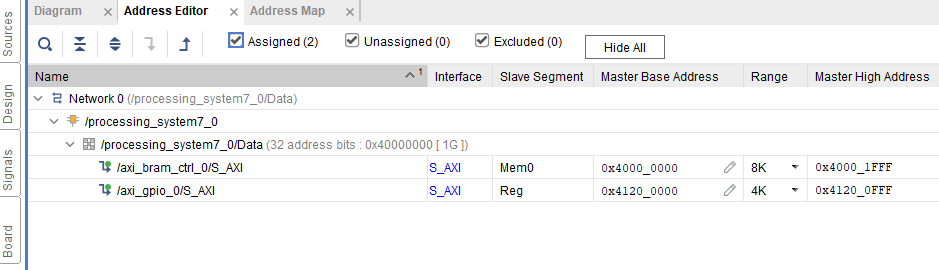
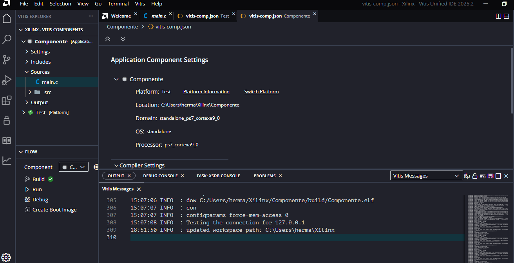

# Laboratorio 04 – SoC Zynq-7000

## Integrantes

- Julian David Gomez Gonzalez - 1007544331
- Cristian Norbey Hernández Gualteros - 1001091723
- Milton Nicolas Rincón Caicedo - 1021312724

**Semestre:** 2026-2

**Plataforma:** Digilent Zybo Z7-10 (Zynq-7000)

**Herramientas:** Vivado (Block Design) y Vitis

---

## Índice

1. [Descripción de la práctica](#1-descripción-de-la-práctica)
2. [Arquitectura del Zynq-7000](#2-arquitectura-del-zynq-7000)
3. [Diseño de bloques en Vivado](#3-diseño-de-bloques-en-vivado)
4. [Mapa de direcciones](#4-mapa-de-direcciones)
5. [De Vivado a Vitis](#5-de-vivado-a-vitis)
6. [Programa en C (`main.c`)](#6-programa-en-c-mainc)
7. [Evidencia de funcionamiento en FPGA](#7-evidencia-de-funcionamiento-en-fpga)
8. [Conclusiones](#8-conclusiones)

---

## 1. Descripción de la práctica

En los laboratorios anteriores todo el sistema se describía en Verilog y se implementaba en la lógica programable de la FPGA. En esta práctica se usa el **procesador ARM** que trae integrado el Zynq-7000: se construye un **SoC** en el *Block Design* de Vivado, sin escribir Verilog, y luego se programa en C desde Vitis.

El sistema final hace parpadear los 4 LEDs de la Zybo y, al mantener presionado un botón, enciende su LED correspondiente. Esa lógica no está en hardware, sino en un programa que ejecuta el procesador y que se comunica con los LEDs y los botones a través de un periférico GPIO.

El flujo de trabajo fue:

**Diseño de hardware en Vivado → Bitstream → Exportación del hardware (XSA) → Aplicación en Vitis → Ejecución en la placa**

---

## 2. Arquitectura del Zynq-7000

El Zynq-7000 combina en un mismo chip dos partes:

| Parte | Qué contiene | Qué se hace en ella |
| --- | --- | --- |
| **PS** (*Processing System*) | Procesador ARM Cortex-A9, cachés, controlador de memoria DDR, periféricos (UART, USB, Ethernet, SPI, I2C, temporizadores, DMA) | Ejecuta software, por ejemplo un programa en C. |
| **PL** (*Programmable Logic*) | LUTs, flip-flops, bloques DSP, memoria BRAM | Implementa hardware digital, como en los laboratorios anteriores. |

Las dos partes se comunican mediante buses **AXI**. Para el procesador, cada periférico de la PL ocupa un rango de direcciones de memoria: leer o escribir en esas direcciones equivale a leer o escribir los registros del periférico.

En esta práctica, el procesador está en la PS, y la memoria BRAM y el GPIO de LEDs y botones están en la PL.

---

## 3. Diseño de bloques en Vivado


### 3.1 Bloques utilizados

| Bloque | Función en el sistema |
| --- | --- |
| **ZYNQ7 Processing System** | Representa la PS dentro del diseño. Entrega a la PL el reloj (`FCLK_CLK0`) y la señal de reset (`FCLK_RESET0_N`), y tiene el puerto maestro `M_AXI_GP0`, por donde el procesador accede a los periféricos de la PL. También expone las conexiones externas de la memoria DDR y de los pines fijos del procesador (`DDR` y `FIXED_IO`). |
| **Processor System Reset** | Toma el reset que viene de la PS y lo sincroniza con el reloj de la PL. Genera los resets para el interconector y para los periféricos, de modo que todos salgan de reset de forma ordenada. |
| **AXI Interconnect** | Conecta un maestro (el procesador) con varios esclavos (la BRAM y el GPIO). Según la dirección de cada lectura o escritura, envía la transacción al periférico correspondiente. |
| **AXI BRAM Controller** | Traduce las transacciones AXI del procesador a las señales que entiende la memoria BRAM: dirección, dato y habilitación de escritura. |
| **Block Memory Generator** | La memoria BRAM, construida con los bloques de memoria internos de la PL. |
| **AXI GPIO** | Periférico de entradas y salidas de propósito general. Sus registros se conectan a pines físicos: el canal 1 a los 4 LEDs (salidas) y el canal 2 a los 4 botones (entradas). Se agregó desde la pestaña *Board*, por lo que Vivado asignó los pines automáticamente. |

### 3.2 Conexiones

- **Reloj:** `FCLK_CLK0` de la PS alimenta el puerto AXI de la PS, el interconector, el controlador de BRAM y el GPIO, de modo que todo el sistema trabaja con el mismo reloj.
- **Reset:** `FCLK_RESET0_N` entra al *Processor System Reset*, que distribuye los resets sincronizados.
- **Datos:** `M_AXI_GP0` de la PS va al interconector, y de este salen dos conexiones AXI: una al controlador de BRAM y otra al GPIO.

### 3.3 Pasos finales del diseño

- **Run Block Automation:** aplicó la configuración de la placa a la PS (memoria DDR y pines del procesador) y conectó sus puertos externos `DDR` y `FIXED_IO`.
- **HDL Wrapper:** Vivado generó un archivo Verilog que instancia el *Block Design* como módulo superior, para poder sintetizarlo e implementarlo como cualquier otro diseño. No fue necesario escribir un `.xdc`: los pines de LEDs y botones vienen de los archivos de la placa.

---

## 4. Mapa de direcciones



En el *Address Editor* se asignó a cada periférico un rango de direcciones dentro del espacio del procesador. El rango del GPIO se redujo de 64 KB a 4 KB, ya que solo tiene unos pocos registros.

La dirección base del GPIO, `0x41200000`, es la que usa el programa en C para acceder a los LEDs y a los botones.

---

## 5. De Vivado a Vitis

1. **Bitstream:** se generó a partir del diseño, como en los laboratorios anteriores.
2. **Exportación del hardware:** con *File → Export → Export Hardware*, incluyendo el bitstream, se generó el archivo **XSA**. Este archivo describe el hardware para el software: qué procesador hay, qué periféricos tiene y en qué direcciones están.
3. **Plataforma en Vitis:** a partir del XSA se creó un *Platform Component* para el procesador `ps7_cortexa9_0`, sin sistema operativo (*standalone*).
4. **Aplicación:** sobre esa plataforma se creó una aplicación vacía, se agregó `main.c`, se compiló con *Build* y se ejecutó en la placa con *Run*.



---

## 6. Programa en C (`main.c`)

### 6.1 Acceso a los registros del GPIO

```c
#define GPIO_BASE 0x41200000

#define LED_REG    *(volatile unsigned int *)(GPIO_BASE + 0x00)
#define BUTTON_REG *(volatile unsigned int *)(GPIO_BASE + 0x08)
```

El procesador ve al AXI GPIO como un conjunto de registros en memoria, a partir de su dirección base:

| Dirección | Registro | Conectado a |
| --- | --- | --- |
| `0x41200000` (base + `0x00`) | Dato del canal 1 | LEDs: escribir aquí enciende o apaga los LEDs. |
| `0x41200008` (base + `0x08`) | Dato del canal 2 | Botones: leer aquí entrega el estado de los botones. |

`LED_REG` y `BUTTON_REG` convierten esas direcciones en "variables": `LED_REG = 0xF` escribe en el registro y enciende los 4 LEDs, y `BUTTON_REG` lee el estado actual de los botones. Cada bit corresponde a un LED o a un botón.

La palabra **`volatile`** le indica al compilador que ese valor puede cambiar por fuera del programa (por ejemplo, cuando se presiona un botón) y que cada lectura o escritura debe hacerse de verdad. Sin ella, el compilador podría optimizar el código y, por ejemplo, leer los botones una sola vez.

### 6.2 Parpadeo y lectura de botones

```c
void delay_with_buttons(unsigned int blink_state)
{
    for (unsigned int elapsed = 0; elapsed < DELAY; elapsed += POLL_INTERVAL)
    {
        unsigned int buttons = BUTTON_REG & 0xF;
        LED_REG = blink_state | buttons;
        for (volatile int i = 0; i < POLL_INTERVAL; i++);
    }
}
```

Esta función mantiene los LEDs en un estado (`blink_state`) durante un tiempo, pero sin dejar de atender los botones:

1. El tiempo total (`DELAY`) se divide en intervalos cortos (`POLL_INTERVAL`), que dan `100000000 / 100000 = 1000` vueltas.
2. En cada vuelta lee los botones. `& 0xF` se queda solo con los 4 bits que corresponden a los botones.
3. Escribe en los LEDs la **OR** entre el estado del parpadeo y los botones: un LED se enciende si toca encenderlo por el parpadeo **o** si su botón está presionado.
4. Espera un intervalo corto con un bucle vacío. El bucle también usa `volatile` para que el compilador no lo elimine.

Si la espera fuera un solo bucle largo, el programa no leería los botones hasta terminarlo, y la respuesta a una pulsación se notaría con retraso. Dividirla en intervalos permite revisar los botones unas 1000 veces por cada fase del parpadeo.

### 6.3 Programa principal

```c
int main()
{
    while(1)
    {
        delay_with_buttons(0xF);   // Fase ON
        delay_with_buttons(0x0);   // Fase OFF
    }
}
```

El programa repite indefinidamente dos fases de igual duración:

| Fase | `blink_state` | Comportamiento de los LEDs |
| --- | :---: | --- |
| ON | `0xF` = `1111` | Los 4 LEDs encendidos, sin importar los botones. |
| OFF | `0x0` = `0000` | Solo se encienden los LEDs cuyo botón está presionado. |

### 6.4 Comportamiento esperado

- Los 4 LEDs parpadean de forma continua.
- Al mantener presionado un botón, su LED queda encendido también durante la fase OFF, por lo que deja de parpadear mientras el botón siga presionado.
- Al soltarlo, ese LED vuelve a parpadear con los demás.

La duración de cada fase depende de la velocidad del procesador, ya que la espera se hace contando iteraciones y no con un temporizador.

---

## 7. Evidencia de funcionamiento en FPGA

https://github.com/user-attachments/assets/REEMPLAZAR-CON-EL-ENLACE-DEL-VIDEO

En el video se observa que:

1. Los 4 LEDs parpadean de forma continua.
2. Al mantener presionado un botón, su LED permanece encendido mientras los demás siguen parpadeando.
3. Al soltar el botón, el LED vuelve a parpadear.

El comportamiento observado coincide con el esperado a partir del análisis de `main.c`.

---


## 8. Conclusiones

- **SoC sin código HDL:** el *Block Design* permitió construir un sistema completo (procesador, memoria, buses y periféricos) conectando bloques, sin escribir Verilog. Vivado generó automáticamente el módulo superior y la asignación de pines a partir de los archivos de la placa.
- **Integración PS–PL:** el procesador ARM de la PS controló un periférico implementado en la PL a través del bus AXI. Para el programa, el GPIO es simplemente un par de direcciones de memoria, lo que muestra cómo el software accede al hardware mediante registros mapeados en memoria.
- **Funciones de los bloques de soporte:** además del procesador y los periféricos, el sistema necesita bloques que los integren: el *AXI Interconnect* dirige cada transacción al periférico correcto según su dirección, y el *Processor System Reset* sincroniza el reset con el reloj de la PL.
- **Hardware y software separados:** el archivo XSA permitió desarrollar el software en Vitis a partir de la descripción del hardware generada en Vivado. Una vez definido el hardware, el comportamiento del sistema se puede cambiar modificando solo el programa en C, sin volver a sintetizar.
- **Diferencia con los laboratorios anteriores:** en los laboratorios anteriores el comportamiento se describía directamente en hardware. Aquí, la lógica de parpadeo y la lectura de botones se ejecutan en software, de forma secuencial, y la PL se usa solo para los periféricos. Esto facilita los cambios, aunque el tiempo de respuesta depende del programa, como se ve en la espera por conteo de iteraciones.
- **Ubicación de los archivos en Vitis:** durante la práctica se encontraron dos problemas relacionados con las rutas. Vitis no permitió usar como espacio de trabajo una carpeta creada dentro del proyecto de Vivado, y al buscar el archivo `.xsa` para crear la plataforma, las rutas muy largas superaban el límite de caracteres que admite la herramienta. La solución fue ubicar el espacio de trabajo de Vitis en una carpeta aparte, con una ruta corta. Conviene definir estas ubicaciones desde el inicio para evitar tener que repetir la creación de la plataforma.

---

## 9. Referencias

- [*Lab04 – SoC Zynq-7000*. (2026). Guía del laboratorio, repositorio 2026-2_Lab_Electronica_Digital_2_G3yG4. GitHub.](https://github.com/jovelasquezs/2026-2_Lab_Electronica_Digital_2_G3yG4/blob/main/labs/lab04/README.md)

- [FPGAs for Beginners. (2023, 28 julio). *Zynq Part 1: Vivado block diagram (no Verilog/VHDL necessary!)*. YouTube.](https://www.youtube.com/watch?v=UZ3FnZNlcWk)

- [AMD. (s. f.). *SoC AMD Zynq™ 7000*.](https://www.amd.com/es/products/adaptive-socs-and-fpgas/soc/zynq-7000.html)
